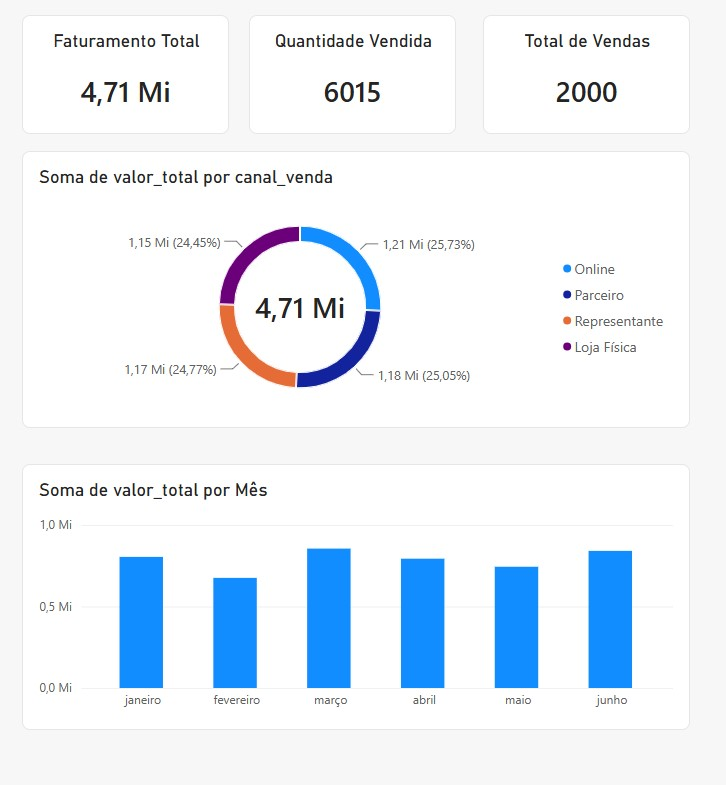

# 📊 Fundamentos do Power BI | Primeiro Dashboard

## 📖 Sobre o Projeto

Este projeto representa meu primeiro contato prático com o Power BI, desenvolvido durante a formação **Educadados**.

O objetivo foi compreender e aplicar o fluxo básico de análise de dados utilizando o Power BI Desktop, passando pelas etapas de importação, tratamento de dados, modelagem inicial e criação de visualizações.

Trata-se de um projeto introdutório voltado para consolidar os conceitos fundamentais da ferramenta.

## 🎯 Objetivos de Aprendizagem

- Importar dados de um arquivo CSV.
- Conhecer o ambiente do Power BI Desktop.
- Realizar transformações básicas utilizando o Power Query.
- Criar medidas e indicadores simples.
- Construir visualizações interativas.
- Organizar informações em um dashboard.

## 🛠️ Tecnologias

- Power BI Desktop
- Power Query
- Arquivo CSV

## 📊 Dashboard Desenvolvido

O relatório apresenta indicadores básicos de desempenho de vendas, incluindo:

### KPIs

- Faturamento Total
- Quantidade Vendida
- Total de Vendas

### Análises

- Distribuição do faturamento por canal de venda
- Evolução do faturamento ao longo dos meses

## 📸 Preview

## 🔄 Etapas Realizadas

### 1. Importação dos Dados

Foi utilizado um arquivo CSV como fonte de dados para o relatório.

### 2. Tratamento dos Dados

Utilizando o Power Query, foram realizadas transformações como:

- Ajuste de tipos de dados
- Verificação da estrutura da tabela
- Preparação dos dados para análise

### 3. Construção do Dashboard

Foram criados:

- Cartões de indicadores (KPIs)
- Gráfico de rosca para análise por canal de venda
- Gráfico de colunas para análise mensal

## 📈 Principais Resultados

O dashboard permite visualizar:

- O faturamento total do período analisado;
- A quantidade total de itens vendidos;
- O número de vendas realizadas;
- A participação de cada canal de venda no faturamento;
- A evolução das vendas ao longo dos meses.

## 📚 Conhecimentos Praticados

Durante o desenvolvimento deste projeto foram praticados os seguintes conceitos:

- Importação de dados
- ETL básico com Power Query
- Modelagem inicial de dados
- Criação de visualizações
- Construção de KPIs
- Organização de dashboards

## 🚀 Como Executar

1. Baixe os arquivos do projeto.
2. Abra o arquivo `primeiro-dashboard.pbix` no Power BI Desktop.
3. Caso necessário, atualize o caminho da fonte de dados.
4. Atualize o relatório para carregar os dados.

## 📁 Arquivos Disponíveis

| Arquivo | Descrição |
|----------|-----------|
| primeiro-dashboard.pbix | Dashboard desenvolvido no Power BI |
| base_Modulo01.csv | Base de dados utilizada |
| dashboard-preview.jpg | Imagem do dashboard |
| README.md | Documentação do projeto |

## 👩‍💻 Autora

**Silvana Campos**

Projeto desenvolvido durante a formação **Educadados** como parte da trilha de aprendizado em Análise de Dados e Business Intelligence com Power BI.

### 🔗 Portfólio Completo

Acesse o repositório principal:

👉 https://github.com/SilvanaCampos/portfolio-powerbi-educadados
