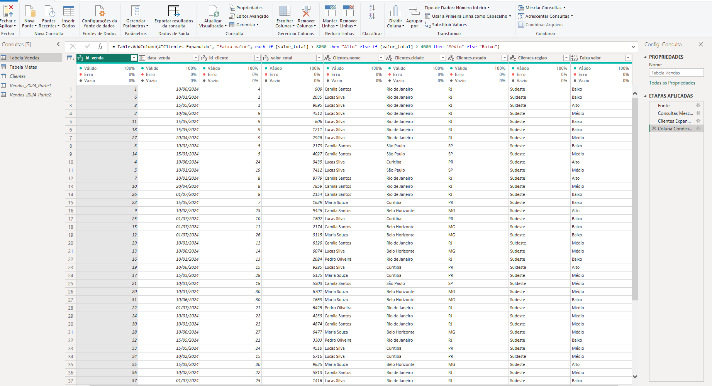

# 🔄 Módulo 02 | Power Query Básico 

## 📖 Sobre o Desafio Técnico

Desafio técnico desenvolvido durante o **Módulo 02 - Power Query Básico** da Formação Analista de Dados da Educadados.

O desafio teve como objetivo aplicar técnicas de preparação, transformação e integração de dados utilizando o Power Query, reproduzindo etapas comuns de processos de ETL (Extract, Transform and Load) em projetos de Business Intelligence.

A solução envolveu padronização de bases, tratamento de inconsistências, enriquecimento de dados e transformação de estruturas para análise.

## 🎯 Objetivos do Desafio Técnico

Prepara e consolidar diferentes fontes de dados em uma estrutura analítica consistente, aplicando recursos fundamentais do Power Query para tratamento, integração e organização dos dados.

## 🛠️ Tecnologias

- Power BI Desktop
- Power Query
- Microsoft Excel

## 📁 Arquivos

| Arquivo | Descrição |
|----------|----------|
| Desafio_PowerQuery_Basico.pbix | Arquivo Power BI contendo todas as etapas de transformação desenvolvidas no desafio |
| Desafio_Tecnico_PowerQuery.xlsx | Base de dados utilizada no desafio |
| resultado-transformacoes-power-query.png | Evidência visual do resultado das transformações |

## 📊 Base de Dados

O desafio utilizou o arquivo: **Desafio_Tecnico_PowerQuery.xlsx**

### Tabelas Utilizadas

| Tabela | Finalidade |
|---------|------------|
| Vendas_2024_Parte1 | Registros de vendas |
| Vendas_2024_Parte2 | Continuação dos registros de vendas |
| Clientes | Informações cadastrais e geográficas dos clientes |
| Metas | Metas comerciais por período |

As tabelas de vendas foram consolidadas por meio de operações de Append. Em seguida, os dados foram enriquecidos com informações da tabela Clientes através de Merge. A tabela Metas foi transformada para formato analítico utilizando Unpivot.

## 🔄 Transformações Implementadas

### Padronização das Tabelas de Vendas

- Ajuste dos nomes das colunas;
- Padronização da estrutura entre as tabelas;
- Correção dos tipos de dados;
- Validação dos registros.

### Tratamento de Datas

- Correção de formatos inconsistentes;
- Conversão para o tipo Data;
- Padronização das informações para análise.

### Consolidação de Dados

- Append entre as tabelas **Vendas_2024_Parte1** e **Vendas_2024_Parte2**;
- Criação de uma base única de vendas.

### Limpeza e Padronização da Base de Clientes

- Remoção de espaços excedentes;
- Padronização de textos;
- Correção de inconsistências;
- Ajuste da coluna Região.

### Transformação de Colunas

Separação da coluna **cidade_estado** em: Cidade; Estado.
 
### Integração de Dados (Merge)

Relacionamento entre as tabelas de vendas e clientes utilizando a chave **id_cliente**.
Campos incorporados: Nome do Cliente; Cidade; Estado; Região.

### Regras de Negócio

Criação de coluna condicional para classificação do ticket de venda: Alto; Médio; Baixo.

### Transformação da Tabela Metas

- Aplicação de Unpivot nas colunas de meses;
- Conversão para formato analítico;
- Renomeação das colunas;
- Adequação da estrutura para modelagem e análise.

## 📸 Resultado das Transformações

A imagem abaixo apresenta a base consolidada após os processos de limpeza, integração e enriquecimento dos dados realizados no Power Query.

## 🚀 Competências Demonstradas

- Power Query;
- ETL Básico;
- Limpeza e Padronização de Dados;
- Tratamento de Datas;
- Append; Merge;
- Coluna Condicional;
- Unpivot;
- Integração de Dados;
- Preparação de Bases Analitica.

## 👩‍💻 Autora

**Silvana Campos**

Desafio técnico desenvolvido durante a formação **Educadados**, compondo meu portfólio de projetos em Power BI, Power Query, Modelagem e Business Intelligence.

---

🔗 Repositório principal:
https://github.com/SilvanaCampos/portfolio-powerbi-educadados
