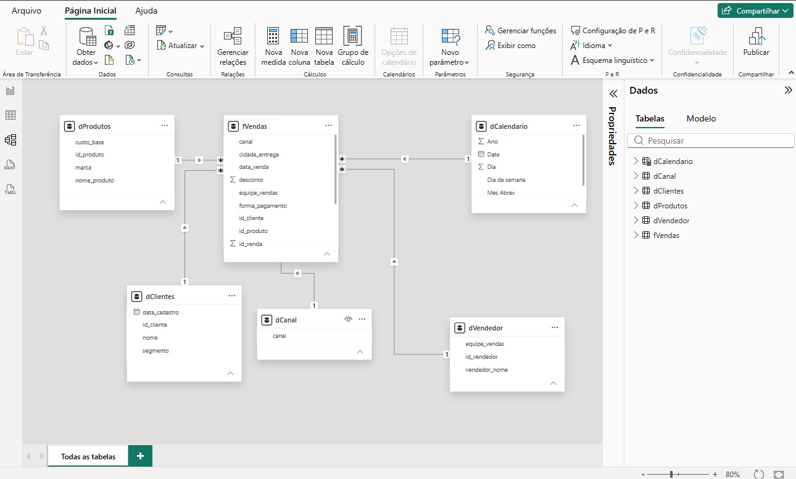

# 📐 Módulo 03 | Modelagem de Dados
## Desafio Técnico de Modelagem Dimensional

## 📖 Sobre o Desafio Técnico

Desafio técnico desenvolvido durante o **Módulo 03 - Modelagem de Dados** da Formação de Analista de Dados da Educadados.

**Objetivo:** transformar uma base transacional de clientes, produtos e vendas em um modelo dimensional (Star Schema) pronto para análises e dashboards no Power BI.

## 🛠️ Tecnologias

- Power BI Desktop
- Power Query
- DAX
- Modelagem Dimensional

## 📁 Arquivos 

| Arquivo | Descrição |
|----------|----------|
| Desafio_Modelagem.pbix | Arquivo Power BI contendo o modelo dimensional desenvolvido |
| Base_Modelagem.xlsx | Base de dados utilizada no desafio |
| modelo-relacionamentos.jpg | imagem do modelo dimensional e dos relacionamentos criados |

---

## 📸 Modelo Dimensional

## 🏗️ Estrutura do Modelo

O modelo segue o **Star Schema (Modelo Estrela)**: uma tabela fato central conectada a tabelas dimensão.

### Tabela Fato

**fVendas** registra as transações de vendas, com informações de clientes, produtos, vendedores, canal de venda, datas, valores e quantidades.

## 📚 Dimensões

| Dimensão | Origem | Finalidade |
|---|---|---|
| dClientes | Já disponível na base | Atributos cadastrais dos clientes, para análises de segmentação e comportamento de compra |
| dProdutos | Já disponível na base | Atributos dos produtos, para análises por produto, marca e custo |
| dCanal | **Criada por mim no Power Query** | Normaliza os canais de venda que estavam na tabela fato |
| dVendedor | **Criada por mim no Power Query** | Separa os dados descritivos de vendedores e equipes da tabela fato |
| dCalendario | **Script DAX fornecido pelo professor** | Suporta análises por dia, mês e ano, com ordenação cronológica correta |

---

##  📌 Destaques da Modelagem
    
### dCanal

Criada como tabela de referência a partir da fVendas, mantendo apenas o campo `canal`, para normalizar os canais de comercialização e permitir análises por canal.

> Observação: o ideal em uma dimensão é ter uma chave identificadora (código/id). Como os canais não possuem código, o próprio campo `canal` foi usado como chave do relacionamento com a fVendas.

### dVendedor

Criada a partir de uma nova importação da fVendas, renomeada para dVendedor, mantendo apenas os campos `id_vendedor`, `vendedor_nome` e `equipe_vendas`. Foram removidas as duplicatas por `id_vendedor`, para que cada vendedor apareça uma única vez e o relacionamento 1:N funcione.

### dCalendario

Criada a partir de script DAX disponibilizado pelo professor, para suportar análises por período. A coluna **Mes Abrev** foi classificada pela coluna **Mes num**, garantindo a ordenação cronológica correta nas visualizações.

---

## 🔗 Relacionamentos

| Dimensão | Chave na dimensão | Chave na fVendas | Cardinalidade | Direção do filtro |
|---|---|---|---|---|
| dCalendario | Date | data_venda | 1:N | Única |
| dClientes | id_cliente | id_cliente | 1:N | Única |
| dProdutos | id_produto | id_produto | 1:N | Única |
| dCanal | canal | canal | 1:N | Única |
| dVendedor | id_vendedor | id_vendedor | 1:N | Única |

---

## 🔄 Etapas Realizadas

1. **Importação** da base disponibilizada para o desafio
2. **Classificação das tabelas** em fato e dimensões
3. **Criação das dimensões**: dCanal e dVendedor no Power Query; dCalendario a partir do script DAX disponibilizado pelo professor
4. **Organização dos atributos descritivos** em dimensões separadas da tabela fato
5. **Configuração e validação dos relacionamentos** entre a fato e as dimensões

## 💡 O que o modelo permite analisar

- Vendas por canal e por vendedor
- Vendas por cliente e por produto
- Evolução mensal e anual, com ordenação cronológica correta

## 👩‍💻 Autora

**Silvana Campos**

Desafio técnico daFormação de Analista de Dados da Educadados, parte do meu portfólio de projetos em Power BI, Power Query, Modelagem de Dados, DAX.

---

🔗 Repositório Principal:
https://github.com/SilvanaCampos/portfolio-powerbi-educadados

