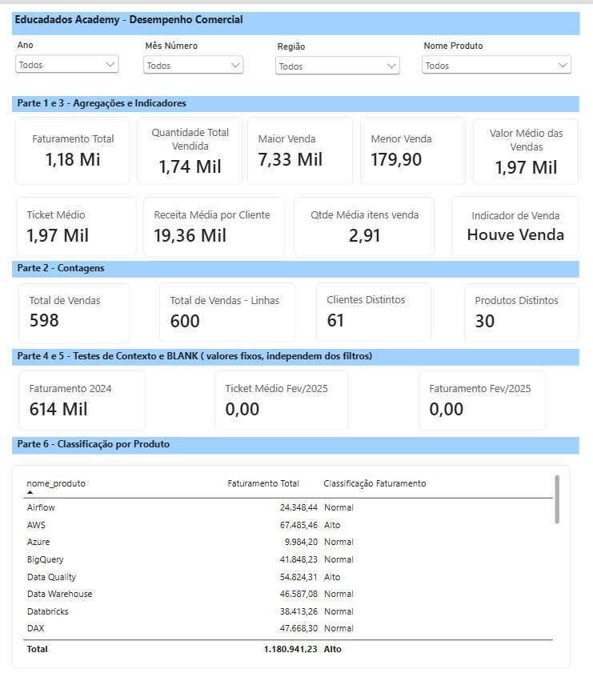
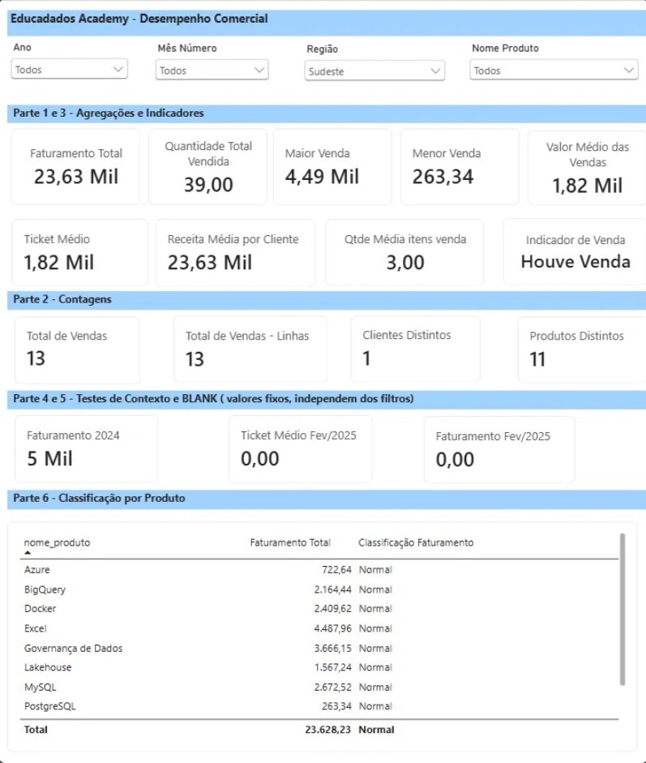
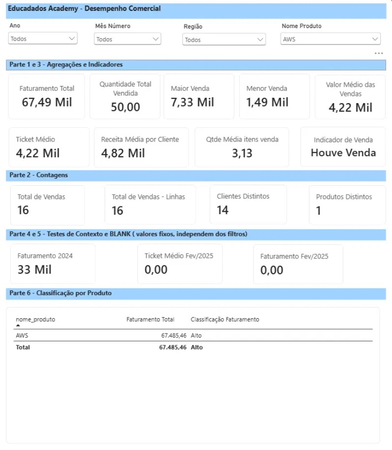
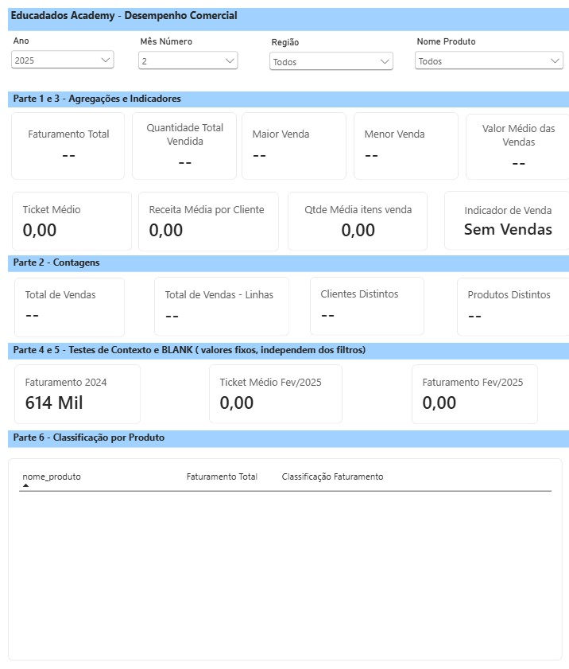

# 🧮 Módulo 04 | DAX Básico

## Desafio Técnico: Desempenho Comercial da Educadados Academy

## 📖 Sobre o Desafio

Desafio técnico do **Módulo 04 - DAX Básico** da Formação de Analista de Dados da Educadados.

**Cenário:** contratada como Analista de Dados da Educadados Academy, uma escola nacional de cursos de tecnologia, a diretoria queria uma visão clara do desempenho comercial dos últimos dois anos. Foram disponibilizadas três bases: **Clientes**, **Produtos** e **Vendas**.

**Missão:** importar as bases, criar os relacionamentos, criar os cálculos necessários em DAX e entregar apenas os números solicitados, sem necessidade de layout.

## 🛠️ Tecnologias

- Power BI Desktop
- DAX
- Modelagem de Dados
  
## 📁 Arquivos

| Arquivo | Descrição |
|---|---|
| Desafio_DAX_Basico.pbix | Arquivo Power BI com o modelo e as medidas DAX |
| Clientes_Desafio_DAX_Basico.csv | Bases utilizadas no desafio |
| Produtos_Desafio_DAX_Basico.csv | Bases utilizadas no desafio |
| Vendas_Desafio_DAX_Basico.csv | Bases utilizadas no desafio |


## 🔗 Modelo de Dados

O modelo deste módulo é formado pelas três bases do desafio e por uma tabela calendário:

- **Vendas_Desafio_DAX_Basico** (fato): `id_venda`, `data_venda`, `id_cliente`, `id_produto`, `quantidade`, `preco_unitario`, `valor_total`
- **Clientes_Desafio_DAX_Basico**
- **Produtos_Desafio_DAX_Basico**
- **dCalendario**

As medidas ficam organizadas em uma tabela própria, **Medidas**, separadas por pasta de exibição.

## 🖥️ Painel de Acompanhamento



---

## 📊 Medidas Criadas

> Todos os valores abaixo vêm do arquivo `Desafio_DAX_Basico.pbix` deste módulo.

### Parte 1 - Agregações

| Indicador | Medida DAX | Resultado |
|---|---|---|
| Faturamento total | `Faturamento Total = SUM(Vendas_Desafio_DAX_Basico[valor_total])` | 1.180.941,23 |
| Quantidade total vendida | `Quantidade Total Vendida = SUM(Vendas_Desafio_DAX_Basico[quantidade])` | 1.742 |
| Maior venda registrada | `Maior Venda = MAX(Vendas_Desafio_DAX_Basico[valor_total])` | 7.333,85 |
| Menor venda registrada | `Menor Venda = MIN(Vendas_Desafio_DAX_Basico[valor_total])` | 179,90 |
| Valor médio das vendas | `Valor Médio das Vendas = AVERAGE(Vendas_Desafio_DAX_Basico[valor_total])` | 1.968,24 |

### Parte 2 - Contagens

| Indicador | Medida DAX | Resultado |
|---|---|---|
| Total de vendas realizadas | `Total de Vendas = DISTINCTCOUNT(Vendas_Desafio_DAX_Basico[id_venda])` | 598 |
| Total de linhas na tabela de vendas | `Total de Vendas - Linhas = COUNTROWS(Vendas_Desafio_DAX_Basico)` | 600 |
| Clientes distintos que compraram | `Clientes Distintos = DISTINCTCOUNT(Vendas_Desafio_DAX_Basico[id_cliente])` | 61 |
| Produtos distintos vendidos | `Produtos Distintos = DISTINCTCOUNT(Vendas_Desafio_DAX_Basico[id_produto])` | 30 |

> **Observação:** o total de vendas usa `DISTINCTCOUNT` e não `COUNT`. O `COUNT` conta todas as linhas com valor na coluna, enquanto o `DISTINCTCOUNT` conta cada venda uma única vez. Por isso a base tem 598 vendas em 600 linhas.

### Parte 3 - Divisão e Indicadores

| Indicador | Medida DAX | Resultado |
|---|---|---|
| Ticket médio | `Ticket Médio = DIVIDE([Faturamento Total], [Total de Vendas], 0) + 0` | ≈ 1.974,82 (painel: 1,97 mil) |
| Receita média por cliente | `Receita Média por Cliente = DIVIDE([Faturamento Total], [Clientes Distintos], 0) + 0` | 19,36 mil |
| Quantidade média de itens por venda | `Qtde Média itens venda = DIVIDE([Quantidade Total Vendida], [Total de Vendas], 0) + 0` | 2,91 |

### Parte 4 - Filtro e Contexto

Faturamento total e ticket médio reavaliados com filtros:

| Filtro aplicado | Faturamento | Ticket médio |
|---|---|---|
| Uma única região (Sudeste) | 23.628,23 | ≈ 1.817,56 (painel: 1,82 mil) |
| Um único produto (AWS) | 67.485,46 | ≈ 4.217,84 (painel: 4,22 mil) |
| Ano de 2024 | 613.930,74 | ≈ 1.918,53 (painel: 1,92 mil) |

**Filtro por região (Sudeste)**



**Filtro por produto (AWS)**



> **Observação:** A medida **"Faturamento 2024"** ignora os filtros de **Ano** e **Mês** da página, mantendo sempre os valores de 2024. Os filtros de **Região** e **Produto** permanecem ativos, conforme demonstrado na primeira imagem acima, na qual o filtro **Sudeste** faz o cartão **"Faturamento 2024** mostrar **5 mil**.

### Parte 5 - BLANK

Filtro aplicado: **fevereiro de 2025**. Sem vendas no período, os cartões de valor ficam vazios, o ticket médio retorna 0,00 e o indicador mostra "Sem Vendas".



- **Faturamento:** retornou vazio (BLANK), pois não há vendas nesse mês
- **Ticket médio:** retornou vazio (BLANK) antes do ajuste [CONFIRMAR]
- **Ajuste:** o ticket médio foi ajustado para retornar 0 quando não há vendas. Medida: `Ticket Médio = DIVIDE([Faturamento Total], [Total de Vendas], 0) + 0`. Em fev/2025 o painel mostra 0,00.

### Parte 6 - IF

**Classificação do faturamento:** Alto (a partir de 50.000) e Normal (abaixo disso). Quando não há faturamento, a medida retorna vazio.

```dax
Classificação Faturamento =
IF(
    [Faturamento Total] > 0,
    IF([Faturamento Total] >= 50000, "Alto", "Normal"),
    BLANK()
)
```

**Indicador de venda no período:** mostra "Houve Venda" ou "Sem Vendas", conforme o período selecionado.

```dax
Indicador de Venda =
IF(
    COUNTROWS(Vendas_Desafio_DAX_Basico) > 0,
    "Houve Venda",
    "Sem Vendas"
)
```

## 💡 O que aprendi neste módulo
- Criar medidas de agregação, contagem e divisão em DAX
- Como o contexto de filtro altera o resultado de uma mesma medida
- O que acontece quando não há dados no período (BLANK) e como tratar esse caso
- Criar classificações e indicadores com lógica condicional

---

## 👩‍💻 Autora

**Silvana Campos**

Desafio técnico da Formação de Analista de Dados da Educadados, parte do meu portfólio em Power BI, Power Query, Modelagem de Dados e DAX.

---

🔗 Repositório Principal:
https://github.com/SilvanaCampos/portfolio-powerbi-educadados

