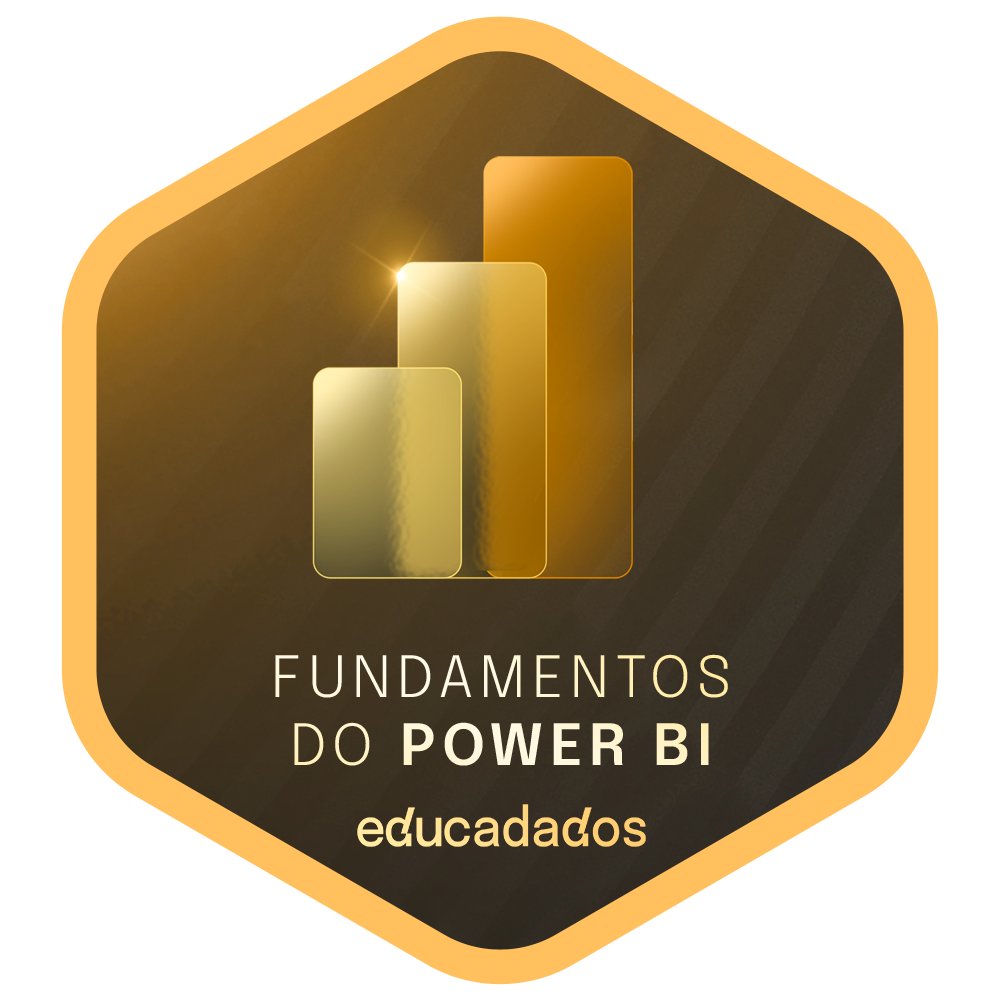
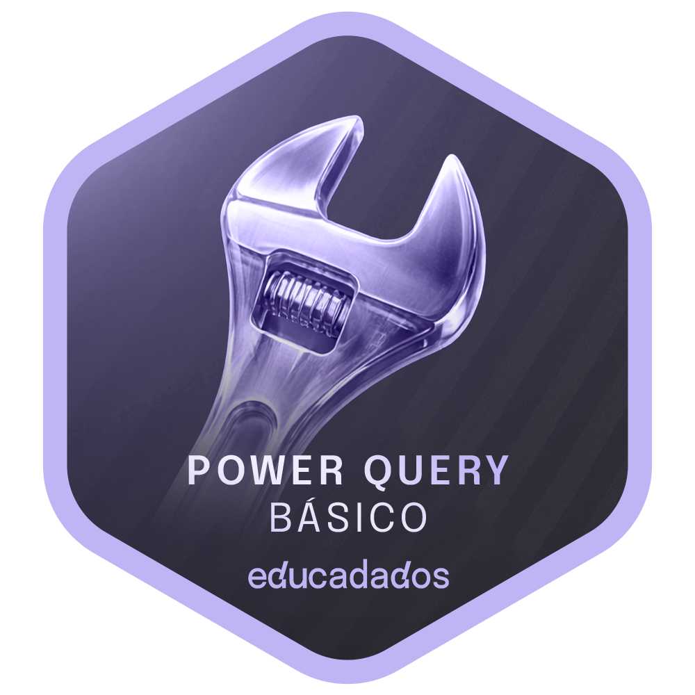
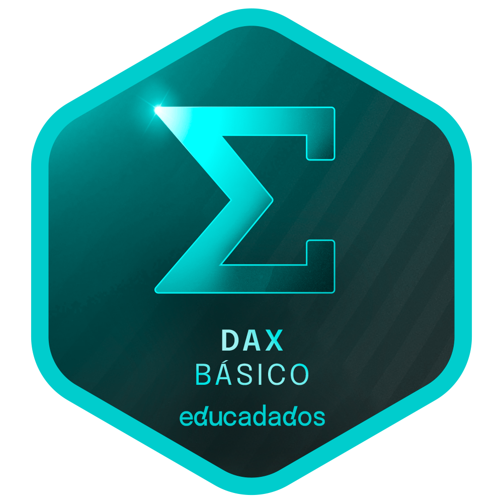

# 📊 Formação Analista de Dados - Educadados

Portfólio de estudos, exercícios, desafios e projetos desenvolvidos durante a Formação de Analista de Dados da Educadados, com foco em Power BI, Power Query, Modelagem de Dados e DAX.

## 🎯 Competências Desenvolvidas

### 📊 Power BI & Business Intelligence
- Power BI
- Power Query
- ETL
- Modelagem de Dados
- DAX Básico

<!DAX Intermediário - Business Intelligence - Visualização de Dados>

### 📈 Conceitos Analíticos

- Modelagem Dimensional
- Star Schema
- Snowflake
- Inteligência de Tempo
- Indicadores e KPIs
  
## 📚 Módulos

✅ Fundamentos do Power BI

✅ Power Query Básico

✅ Modelagem de Dados

✅ DAX Básico

<!-- DAX Intermediário--> 
<table>
<tr>
<td align="center">
<a href="./01-fundamentos-power-bi/">
 
<b>Módulo 01</b> 
Fundamentos do Power BI
</a>
</td>

<td align="center">
<a href="./02-power-query-basico/README.md">
 
<b>Módulo 02</b> 
Power Query Básico
</a>
</td>

<td align="center">
<a href="./03-modelagem-de-dados/README.md">
 
<b>Módulo 03</b> 
Modelagem de Dados
</a>

</td>
<td align="center">
<a href="./04-dax-basico/README.md">
 
<b>Módulo 04</b> 
DAX Básico
</a>

</tr>

<!--- <tr>
<td align="center">
<! <a href="./05-dax-intermediario/README.md">
 
<b>Módulo 05</b> 
DAX Intermediário

</a>
</td>

<td align="center">
<! <a href="./05-dax-intermediario/README.md">
 
<b>Módulo 06</b> 
DAX Intermediário
</a>
</td>
</tr>
</table>

